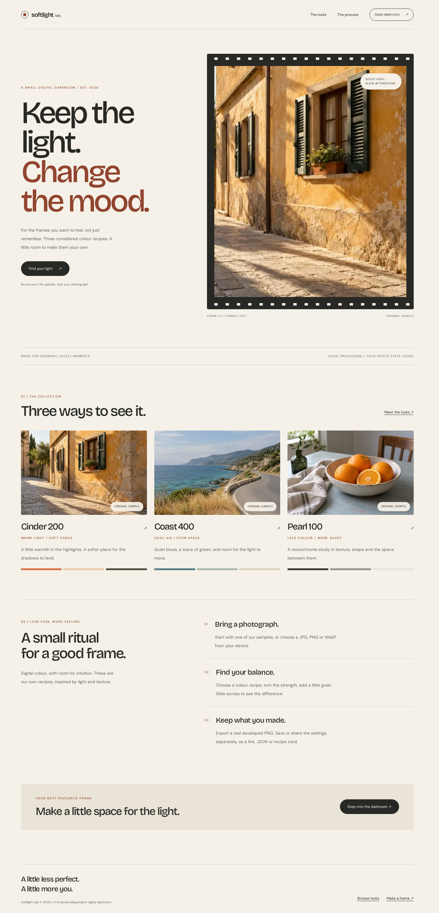
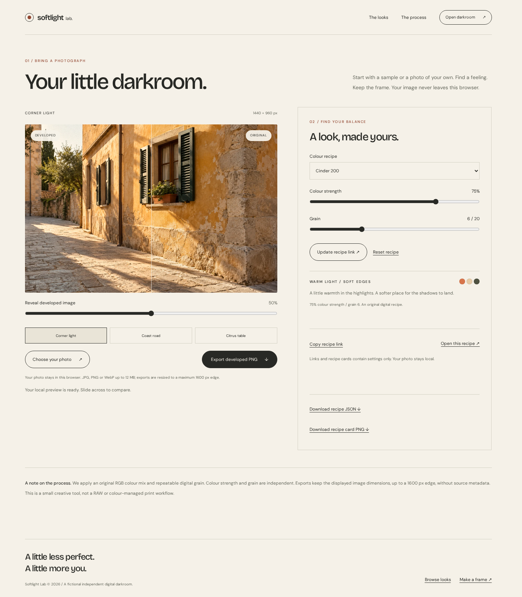
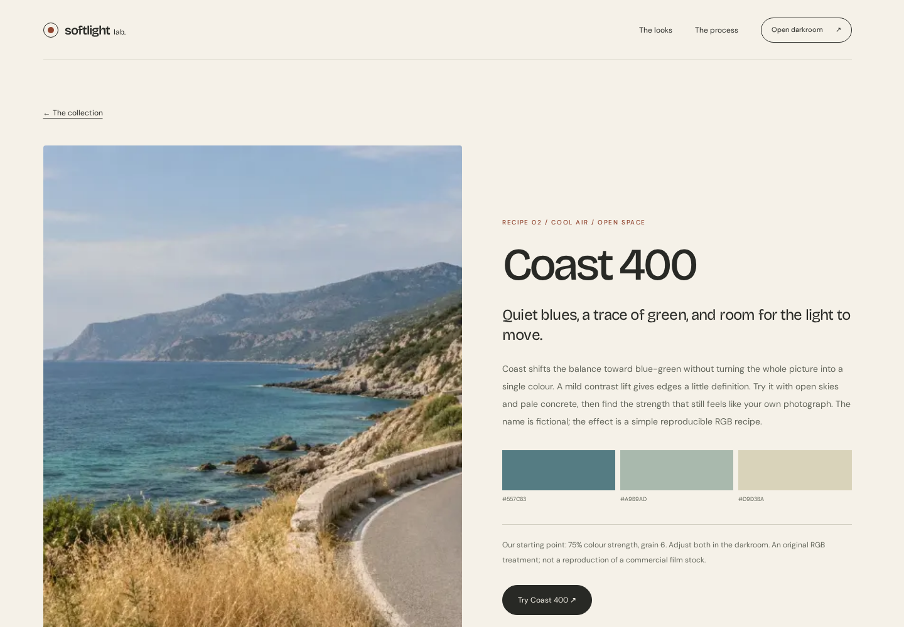
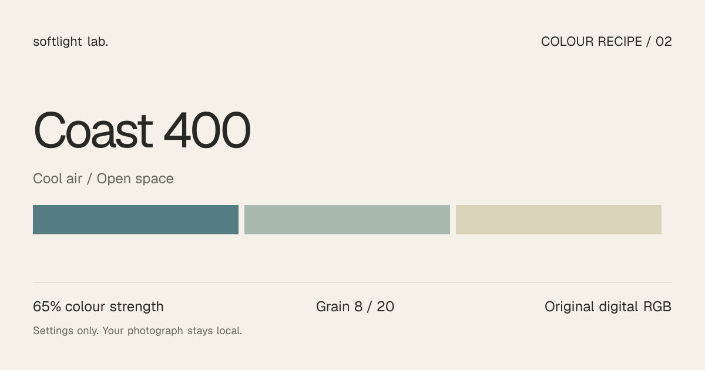
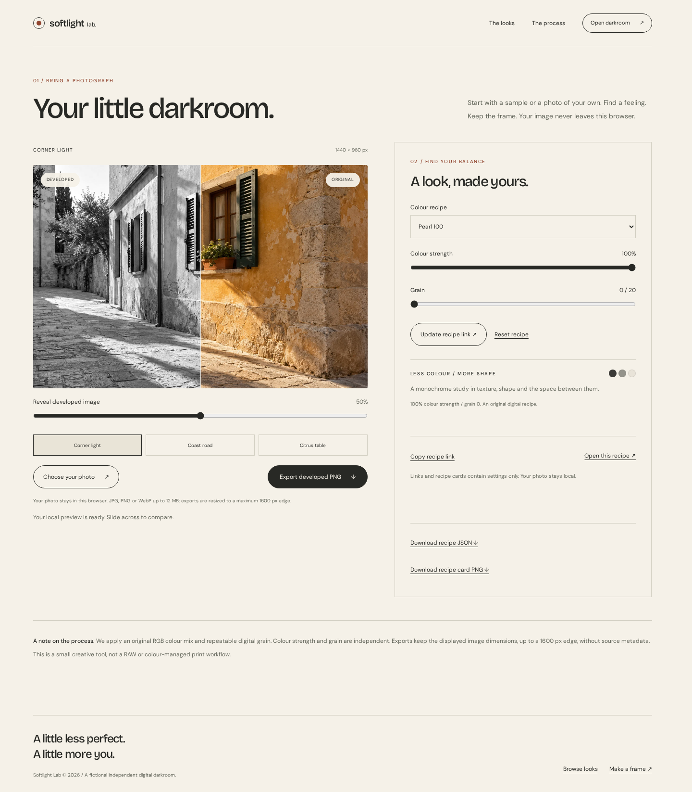

# Softlight Lab

### Keep the light. Change the mood.

A small digital darkroom with an editorial front door. Three original colour recipes, a private local photo preview and a real developed PNG to keep. Built with **Next.js 16, React 19, TypeScript and Tailwind CSS 4**.



## ☀️ A different atmosphere

**Cinder 200** warms an afternoon. **Coast 400** brings cooler blue-green air. **Pearl 100** takes the frame into monochrome. These are fictional, original digital RGB recipes, not commercial film-stock simulations.

The collection and stories show clearly labelled **original samples**. The darkroom applies the actual treatment to those samples or a photograph you choose from your device.

## 🧪 Step into the darkroom

```bash
npm ci
npm run dev
```

Open **http://localhost:3000**. Use Node **24.14.0** (`nvm use`). No `.env`, account, API key or service is required.

1. Choose a sample or a local JPG, PNG or WebP.
2. Select a look. Adjust colour strength and independent grain.
3. Move the reveal slider to compare the original and developed pixels.
4. Export a PNG, or save just the settings as a recipe link, JSON or PNG card.



## ⚛️ Where Next and React earn their place

| Feature                          | What it does here                                                                                                                                  |
| -------------------------------- | -------------------------------------------------------------------------------------------------------------------------------------------------- |
| Server Components                | Render the landing, collection and look stories without the editor pipeline.                                                                       |
| `generateStaticParams`           | Prerenders the three story routes; unknown slugs return a real 404.                                                                                |
| `next/dynamic`                   | Splits the browser canvas editor from the server-rendered controls.                                                                                |
| Native module Web Worker         | Runs RGB transforms and deterministic grain away from the UI thread. Transfers pixel buffers; keeps only one active and the latest pending render. |
| React refs and effects           | Preserve the selected photo when controls change; cancel fetches, terminate workers and revoke export object URLs.                                 |
| `next/form`                      | Enhances a normal GET recipe form. The form and settings downloads also work without JavaScript.                                                   |
| Route Handlers                   | Validate the same recipe contract before exporting JSON or a card.                                                                                 |
| `ImageResponse`                  | Generates a real 1200 × 630 recipe PNG and recipe-specific Open Graph image.                                                                       |
| `next/image` / `next/font/local` | Serve local sample images and self-hosted fonts; no remote image or font service.                                                                  |

## 🔒 Your frame stays here

Local photos are decoded and developed in the browser. There is no photo-upload endpoint, analytics, database, cookie or local-storage photo cache. Reloading clears the selected photo. Recipe links and server-generated cards contain **settings only**.

- Inputs: JPG, PNG and WebP up to **12 MiB**, checked by file signature before browser decoding.
- Processing and export: longest edge at most **1600 px**, preserving aspect ratio; small images are not enlarged.
- Export: canvas-generated PNG, without the original file metadata. Transparency is preserved by the pixel transform.
- Grain: deterministic for the same image size and settings, independent of colour strength.
- Worker unavailable or failed: the same processor falls back to the main thread.
- This is an RGB creative tool. It does not handle RAW files, preserve embedded colour profiles, simulate film chemistry or provide a print-proofing workflow. The browser decodes an input before the processing resize.

## 🗺️ A few well-lit rooms

| Route                                     | Purpose                                            |
| ----------------------------------------- | -------------------------------------------------- |
| `/`                                       | Editorial landing and three-step process           |
| `/looks`                                  | The colour collection                              |
| `/looks/cinder-200`                       | Warm recipe story                                  |
| `/looks/coast-400`                        | Cool recipe story                                  |
| `/looks/pearl-100`                        | Monochrome recipe story                            |
| `/lab?look=coast-400&strength=65&grain=8` | Shareable settings; your photo is never in the URL |
| `/api/recipe?...`                         | Validated recipe JSON attachment                   |
| `/api/look-card?...`                      | Recipe PNG; add `download=1` for an attachment     |



## 🛠️ Make it your own

Start with [CUSTOMIZATION.md](docs/CUSTOMIZATION.md). Recipe data lives in `src/data/looks.ts`; the independently testable processor lives in `src/domain/pixels.ts`. The worker and fallback use that same processor.

[DEVELOPING-CONTRACT.md](docs/DEVELOPING-CONTRACT.md) explains pixel math, job ordering, URL validation, file handling and export boundaries. [ASSETS.md](docs/ASSETS.md) records the original generated sample photography and local font licences.

## 🚀 Deploy on Vercel

Import this directory as a standalone **Next.js** project. `vercel.json` specifies `npm ci`, the production build and basic response headers. No output-directory override or external service is needed.

The fallback origin is **https://next-film-darkroom.vercel.app**. Vercel's `VERCEL_PROJECT_PRODUCTION_URL` takes priority when present; optional `NEXT_PUBLIC_SITE_URL` takes highest priority for a custom domain. Vercel can assign a different hostname when a name is already taken, so confirm the assigned domain. Rebuild after changing the site URL. `.env.example` documents the optional override.

Local production preview:

```bash
npm run build
npm start
```

## ✅ Check the frame

```bash
npm run format:check
npm test
npm run typecheck
npm run build
npx playwright install chromium --only-shell
npm run test:e2e
```

GitHub Actions runs these checks automatically on pushes and pull requests. The VS Code Actions extension is optional. Browser tests exercise real worker pixels, PNG decoding, private uploads, invalid files, worker failure recovery, native GET forms without JavaScript, API validation, accessibility and stable responsive layouts.

Optional asset utilities:

```bash
npm run assets:social
# With a production server running at http://127.0.0.1:4218:
npm run preview:images
```

Neither utility participates in ordinary startup. [VERIFICATION.md](docs/VERIFICATION.md) records the checked environment and results; [DEPENDENCIES.md](docs/DEPENDENCIES.md) explains each package.

## 🖼️ A recipe to keep





## 📄 Licence

Code is MIT licensed. Font notices are preserved in [docs/licenses](docs/licenses). Softlight Lab is a fictional template brand. Generated sample photographs and their exact prompts are documented in [ASSETS.md](docs/ASSETS.md).
